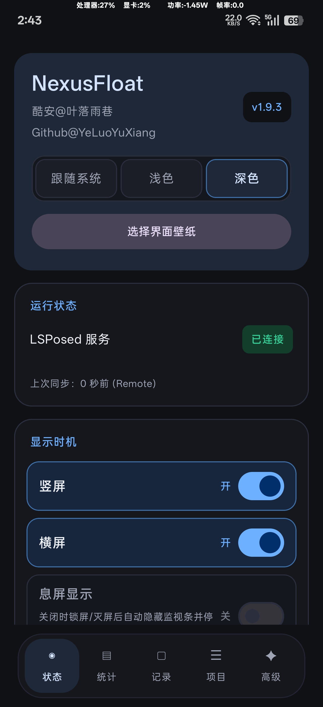
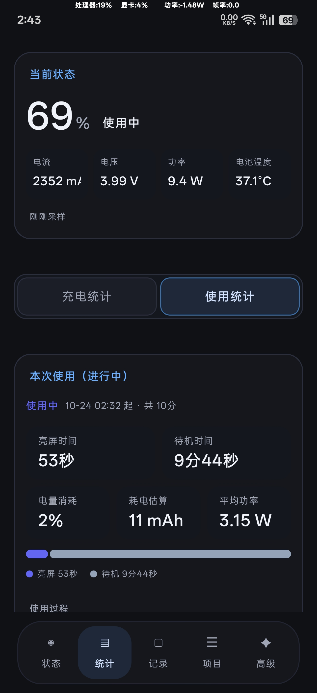
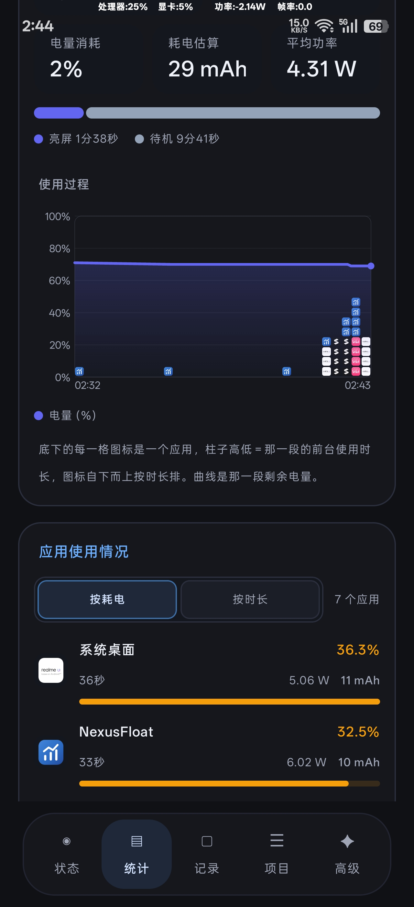
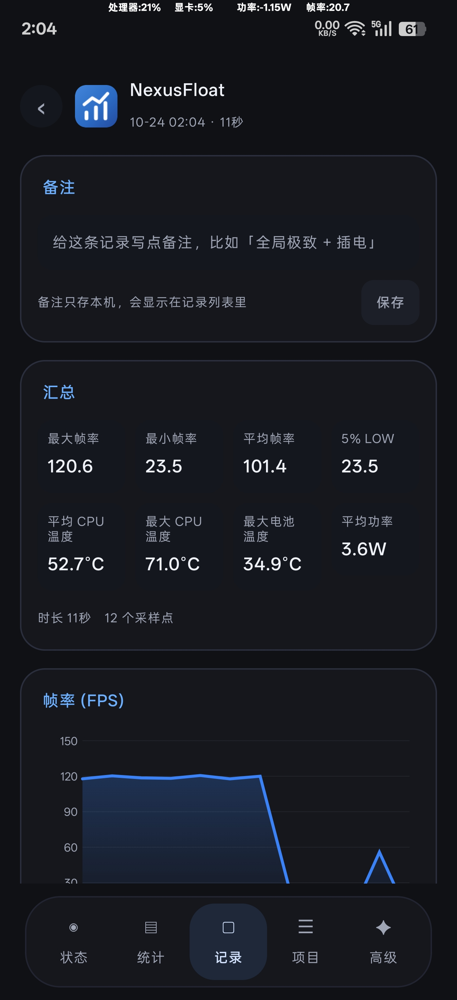
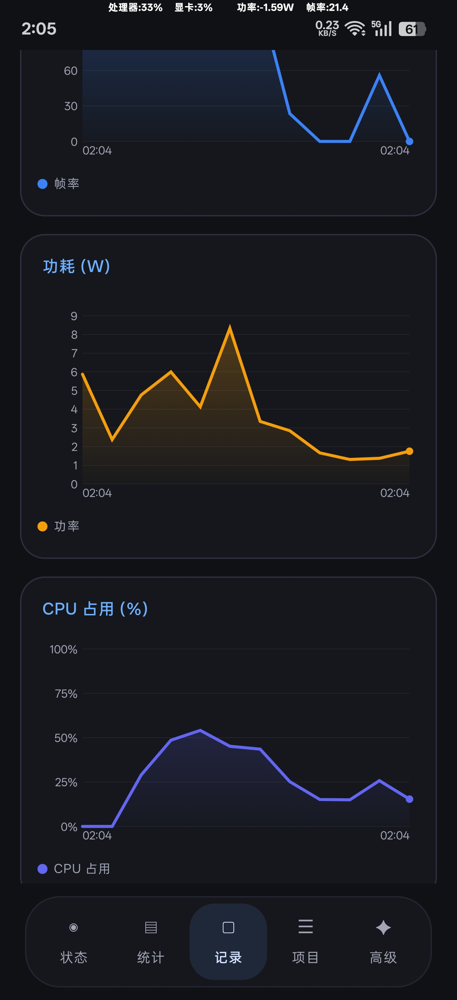
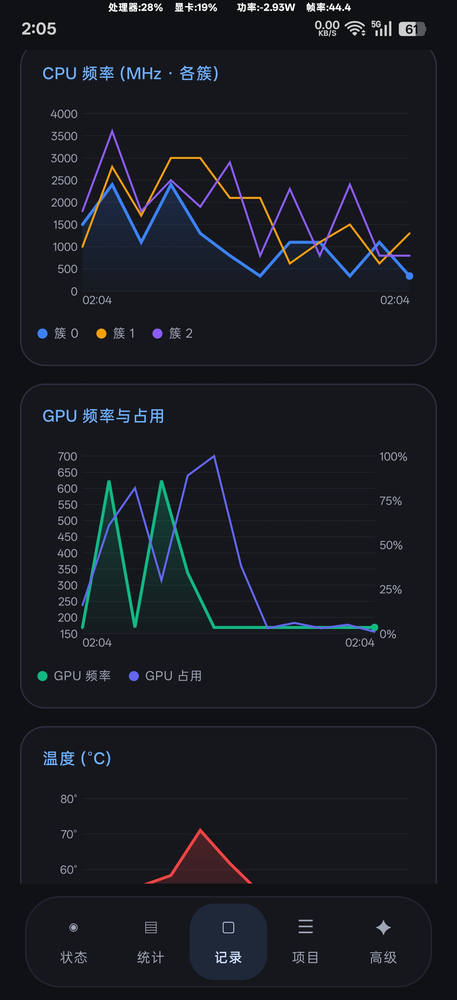

# NexusFloat

酷安@叶落雨巷

一个 LSPosed 模块，在状态栏位置显示一条悬浮性能监视条。

跑在独立悬浮窗里，不是状态栏的子 View，所以全屏玩横屏游戏、看视频时它照常显示，
不用下滑呼出状态栏。竖屏横屏可以分开开关，各项指标各自带开关，关掉的项目不占位置。

当前版本：**1.9.3**


App 首页（状态页）：



除了监视条，这一版还并入了两套独立功能：**充电与使用统计**（后台长期记录电池和
应用用电）和**帧记录**（手动开一次，记一段时间的帧率）。两者都是本机数据，不联网。

## 一、安装和使用

1. 安装 APK
2. LSPosed 里勾选作用域「系统界面」
3. 打开 App 按需配置
4. 按首页「维护」按钮，重启系统界面

GPU 数据需要 root，管理器不授权 root 的话其余指标照常工作。

蓝奏云网盘持续更新链接: https://wwbfn.lanzoum.com/b01gia9ssh
密码:6e83

注意事项:

1. 新版 LSP 启用模块时提示「由于被某个应用遮挡了界面，因此管理器无法验证您的回应」，
   只需要去 LSP 设置里把「界面风格」改为 Material，或者把「点按劫持缓解」关闭。
2. GPU 数据需要 root，管理器不授权 root 的话其余指标照常工作。GPU 实时更新依赖
   App 进程存活，需把耗电改成完全允许后台。
3. 正式版大版本更新必须重装，Debug 版本不要自行尝试安装。
4. 每版本更新内容看首页最下更新日志。

## 二、监视条的项目

| 项目 | 说明 |
| --- | --- |
| 时间 | 可切 12 / 24 小时制 |
| CPU | 占用率，可另开频率（最低-最高）和占用柱状图 |
| GPU | 占用率，可另开频率和柱状图 |
| RAM | 占用百分比 |
| ZRAM | 占用百分比 |
| 温度 | 电池温度 |
| 功率 | 电池充放电功率，带正负号 |
| 电流 | 电池电流，带正负号 |
| FPS | 见下面「监视条的帧率取数」 |
| CPU温度 | 从 thermal_zone 里自动识别 CPU 那一路 |
| 网速 | 实时收发速率，MB/s，保留两位小数 |

默认只开 **CPU、GPU、功率、FPS** 四项，其余在「项目」页里按需打开。

功率和电流带正负号：正表示电在进电池，负表示在出。插着充电器时也不一定就是正的
——高负载功耗超过充电器供电时，电池其实在放电，这时显示为负。正负判断依据是电池
的 `status` 节点和电流的实际流向，不看系统的充电状态（插上 USB 后它一直报「充电中」）。

每个项目的显示名称都能自定义，右侧 ↑↓ 调整在监视条上的排列顺序。

「项目」页里还有这些开关：

- **CPU / GPU 柱状图**——占用率旁边画一排小竖条，看波动比只看数字直观
- **CPU 频率**——括号里显示「最低-最高」，只有一项在跑时只显示一个值
- **GPU 频率**——同理，括号显示当前 GPU 频率
- **双电芯**——部分机型的 `current_now` 只报单颗电芯的电流，功率和电流会偏小一半，
  打开后按 2 倍显示

「外观与校正」页可调：

| 设置 | 说明 |
| --- | --- |
| 字号 | 拖动调整，监视条所有文字一起变 |
| 字体加粗 | 关掉后变细，小字号下更清爽 |
| 字体颜色 | 自带几个预设色，也可以自己挑 |
| 自动反色 | 跟着系统状态栏图标的明暗自动切深浅色，不用手动换 |
| 项目间隔 | 各项之间的距离，挤还是疏 |
| 位置微调 | 监视条整体上下左右偏移几个像素 |
| 背景 | 关掉时完全透明；也可以选一张手机里的图片当背景 |

「状态」页的「显示时机」有四个开关：

- **竖屏显示** / **横屏显示**——可以只开一个方向，另一个方向不出现
- **息屏显示**——关掉后一锁屏就消失（默认关，省电）
- **仅充电时显示**——电池确实在进电时才显示。插着线但功耗超过供电、
  电池在掉电时不算充电，会隐藏

网速来自 `/proc/net/dev` 的累计字节数，两次采样相减再除以时间差。只统计
`wlan` / `rmnet` / `ccmni` / `eth` / `p2p` 这几类对外接口：回环（`lo`）上跑的是
本机进程间通信，算进去会虚高；VPN 的 `tun` 会把同一份流量再算一遍，导致翻倍。

## 三、监视条的帧率取数

这是整个模块花时间最多的地方。FPS 有六个来源，各自一个开关，按下面的顺序
依次尝试，取到就停。数值后面会跟一个来源字母（诊断模式），某个来源在这台机器上
不准时，按字母关掉对应的那个就行。

| 顺序 | 来源 | 字母 | 原理 |
| --- | --- | --- | --- |
| 1 | 面板 measured_fps | p | 高通 sde 驱动给每个 crtc 挂的节点，读的时候现算帧率 |
| 2 | SurfaceFlinger latency | b | 走 Binder 直接问 SurfaceFlinger，按 layer 取帧时间戳 |
| 3 | SurfaceFlinger TimeStats | t | dumpsys 里的逐层帧统计，约 1 秒窗口 |
| 4 | FPSGO | g | 联发科内核按进程统计的 queue buffer 帧率 |
| 5 | GED KPI | f | 联发科 GED 模块的逐进程帧率 |
| 6 | Choreographer | x | 只能测到屏幕刷新率，不是应用帧率，仅作兜底 |

### 1. 高通面板节点

高通的 `measured_fps` 有几个坑，都踩过：

- 每个 crtc 都挂一个节点，只有主屏那个是真实读数，其余恒为 0。不能取第一个，
  要把通配展开成具体路径逐个读。
- 主屏 crtc 不一定叫 `crtc-0`。骁龙 8 Gen 3 / 8 Elite 上主屏藏在「外部 crtc」
  下面，路径形如 `/sys/class/drm/card0-sde-crtc-2/device/card0-sde-crtc-0/measured_fps`，
  通配得写到五层深。
- 节点内容是读取时现算的：内核从每帧时间戳的环形缓冲里往前找跨度够 1 秒的那帧，
  帧数除以时间差就是帧率。原版内核输出 `fps: 59.4`，ColorOS / HyperOS 会多带
  `duration` 和 `frame_count`。
- `frame_count` 是「当前时刻往前 1 秒窗口里的帧数」，不是累积器，随读取时机变化。
  早先版本拿它当「面板有没有在出帧」的判据，结果窗口内帧数少于一帧时整个面板方案
  被判死，这就是「p 方案突然不工作」的来源。现在只看 `fps` 字段。

面板读不到时会退回 `vsync_event` 差分：那是内核写的 vsync 中断时间戳，主屏那个非零、
闲置 crtc 恒为 0，两次读数相减就是帧率。

### 2. TimeStats

逐层的帧统计。直接按累计帧数排名会把静止的壁纸、桌面排到前面，所以做了几件事：
启用时先清零统计；只取前 32 层；排除状态栏、监视条自身这类每秒 1 帧的噪声层；
优先匹配前台包名对应的 layer。

## 四、充电与使用统计

后台按固定间隔（默认 15 秒）采一次电池状态，存进本机数据库。插上充电器开始一次
**充电会话**，拔掉就收尾并聚合；两次插电之间算一个**放电周期**。

能看到的：

- **充电曲线**：这次会话里的功率、电量、温度采样点
- **充入电量**：按电流积分算，不用电量差乘容量——涓流阶段电压掉得快，按容量差算会偏小
- **充电时长**、峰值功率、平均功率
- **放电周期**：亮屏时长、各应用前台时长、应用耗电排行

应用前台时长优先问系统的 `UsageStatsManager`（准，但要「使用情况访问」权限），
拿不到就退回采样积分——按采样间隔累加当前前台包。功耗归因只能走采样积分，
系统不对外提供逐应用的实时电流，所以那个数字是相对值，看排名用。

采样间隔可调 5–120 秒，明细保留 45 天；会话和周期的汇总行永久保留，明细清掉之后
历史记录页的头部数字还在。

统计页还能：

- **常驻通知开关**——关掉只是不显示那条通知，采样照跑
- **仅亮屏时记录**——充电期间这个开关会自动失效（充电统计要的是完整曲线）
- **数据分页**——充电历史和使用周期历史各一张列表，点进去看当次的采样明细
- **一键清空**——在「使用统计设置」里，清掉的是明细，汇总行保留

应用使用情况（各应用功率与前台时长）：





## 五、帧记录

跟统计完全是两回事：统计是「常年在后台默默记」的低频采样，帧记录是「用户手动开
一次、记一会儿」的高频采样。

首次开启悬浮球时会提示授予「使用情况访问」权限并引导到系统设置页——帧记录要按
当前前台应用匹配帧率数据。这个权限没有运行时弹窗，只能由用户手动开启；不给也能用，
只是帧率来源会少几路。

点「开始记录」后屏幕上出现一个悬浮球，切到游戏里也能一直采，长按悬浮球结束。
球上直接显示当前帧率（一位小数）：未记录时黄色、记录中红色，看颜色就知道在不在记。
1 秒一个采样点，记的是帧率、CPU / GPU 频率与占用、温度、功耗，记完在页内看曲线
和汇总。汇总按两排八格摆：最大帧率、最小帧率、平均帧率、5% LOW 帧率；平均与最大
CPU 温度、最大电池温度、平均功率。温度曲线画 CPU 和电池两条，CPU 频率按各簇分线。

两套数据分两个数据库（`nexus_stats.db` 和 `nexus_frames.db`）：清空统计不会连帧
记录一起清掉。一次记录至少 5 个采样点才留存，误触一秒就停掉的不会留下空记录。

记录页还能：

- **按应用筛选**——底部操作条点「筛选」，只看某个游戏的记录
- **多选删除**——长按列表项进入多选，可整条删或全部清空
- **写备注**——每条记录都能加一句文字，比如「王者荣耀 120 帧 + 最高画质」，
  回头翻记录时知道当时测的是什么场景

悬浮球的样式：未记录时黄色、记录中红色，背景 20% 透明，字号固定不随数值位数缩放。

帧记录的 CPU 占用用逐行容错的方式读 `/proc/stat`——一行认不出来只丢这一行，按
CPU 号落位而不是靠行的先后，第一拍就出数。App 进程读不到时自动改走 root 通道
再读同一份文件，数值和监视条对得上。

帧率取数用的是和监视条同一批读取器（面板 → SurfaceFlinger → TimeStats → FPSGO
→ GED）。区别在于帧记录跑在模块 App 进程里，需要先知道当前前台应用是谁才能按
包名找 layer，这部分由 `UsageStatsManager`（要「使用情况访问」权限）配合 root 兜底。

功率、电流、电压也走监视条那套实现（`BatteryGauge`）：电流和电压直接读内核节点
而不是 BatteryManager，方向靠电池的 `status` 节点加电流符号判断。两边算出来的
功率因此能对得上，插着充电器打游戏时该显示负值也一致。

帧率同样与监视条同步：SystemUI 每算出一拍帧率就写进 `Settings.Global`，帧记录
优先读这个值，读不到才退回自己算。这样两处显示的帧率始终一致，不会出现监视条
显示 60、记录页却是 `--` 的情况。

记录详情页（汇总、曲线）：







## 六、取数开销

监视条每秒读一轮节点。root 通道不用 `cat`。

一开始的写法是常驻一个 `su`，每读一个节点发一条 `cat path`。常驻 su 省掉了 su 自身的
fork，但 `cat` 在 Android 上是 toybox 的软链，每次都要 fork + exec 一次 toybox。
一轮采集扫十几个候选路径，等于每秒十几次进程创建，这才是耗电的大头。

现在改用 shell 内建的 `read`：

```sh
read -r v < /sys/class/.../scaling_cur_freq
```

完全在 shell 进程内完成，零 fork。再把一轮里的所有路径合并成一条命令、一次管道往返
读回来，于是：

| | 旧 | 现在 |
| --- | --- | --- |
| 每轮进程创建 | 十几次 | 0 |
| 每轮管道往返 | 每节点一次 | 一次 |

读不到时按退避策略降低重扫频率：连续 3 轮没命中就转退避，之后每 5 轮真扫一次。
这个 5 轮是从 60 轮降下来的。60 轮意味着锁屏期间退避一路累积，亮屏后要等近一分钟
才恢复出数。

电池的电流和电压也是每拍直接读内核节点（`current_now` / `voltage_now`），不用
系统广播和 `BatteryManager` 的值。那两个来源只在电池状态「有变化」时才刷新，
静态场景下可能几十秒不动，会让功率数字看着像卡住。

## 七、模块结构

装完之后有两部分在跑。

### 1. SystemUI 进程（被 LSPosed 注入）

- 挂监视条悬浮窗，按屏幕方向、应用白名单、亮灭屏状态决定显示与否
- 自己读 CPU / RAM / 温度 / 部分 GPU 节点
- 隐藏时不只是不可见，采集线程一并停掉

注入只在主 SystemUI 进程进行。三星等系统会按需拉起
`com.android.systemui:multiwindowui` 从进程（多窗口 / PiP 是主要诱因），
该进程同样会被 LSPosed 注入；不在入口拦掉它，两个进程就会各自建一个同名悬浮窗，
两个窗口的 BufferQueue 向 SurfaceFlinger 提交同一坐标的图层，合成后即重影。
窗口的添加与移除另有一层状态机保护，避免两条驱动路径（每秒轮询与配置变化广播）
交叉执行时重复 addView。

注入走了两条路，互为备份：

- Hook 折叠状态栏 Fragment 的 `onViewCreated`，能直接拿到状态栏的 View 树。
  类名在 Android 各版本里改过多次，所以维护了一张候选表逐个试。
- Hook `Instrumentation.callApplicationOnCreate` 和 `Application.attach`，
  再轮询 `ActivityThread.currentApplication()`。这条路不依赖任何 ROM 类名，
  是 Fragment 全部改名后的保命通道。

### 2. 模块 App 进程

- 用常驻 root shell 读 GPU 频率和占用，读到后写给 SystemUI
- 保持常驻，供 SystemUI 随时取数
- 统计采样和帧记录的前台服务也在这里跑

SystemUI 里 su 不可靠（SELinux 对 system_server 类进程管得严），所以 GPU 取数放在
普通 App 进程里做。1.8.6 起 SystemUI 侧也会先自己试一次 root 直读，读不到才等
App 进程传，这样重启后 App 进程没起来时 GPU 数据也不会断。

ColorOS 在最近任务里点「全部清除」会把模块进程置为 stopped 状态（等同
`am force-stop`）。这个状态下系统只放行带 `FLAG_INCLUDE_STOPPED_PACKAGES`
的广播，普通广播和 ContentProvider query 都送不到，GPU 数据就会停更。
划卡只是普通杀进程、不置 stopped，所以划卡没事。

「显示时机」里的「后台唤醒」就是修这个的：SystemUI 按设定间隔（默认 15 秒）
发一条带那个 flag 的广播，把模块进程唤醒。设 0 可关闭。

### 3. 设置怎么同步

App 改设置，SystemUI 得知道。三层通道依次尝试：

- RemotePreferences（LSPosed 提供的跨进程 prefs）
- ContentProvider 快照——App 侧把设置写进一个 exported Provider，SystemUI 直接查
- `Settings.Global` 里的 Base64 blob——前两条都不通时由 root 写入

三条都不要求 LSPosed 服务绑定成功，所以 App 界面显示「未连接」时设置照样能生效。

## 八、App 界面

底部五个页签：

- **状态**——LSPosed 连接状态、显示时机、重启系统界面、使用须知
- **统计**——充电曲线、使用统计、采样设置
- **记录**——设备信息、历史记录、悬浮球开关
- **项目**——各指标开关与自定义名称、显示顺序、空格自定义、柱状图与频率开关
- **高级**——FPS 六个来源开关、预设、刷新时间、双电芯、后台唤醒

「状态」页除连接状态外，还有「显示时机」四个开关、「维护」（重启系统界面）、
「使用须知」和「更新日志」。

界面支持浅色 / 深色 / 跟随系统，也可以选一张手机里的图片当背景。

## 九、关于空格

监视条默认各项紧贴、不留空格。想在哪里留空，在「项目」页的「空格自定义」里填
「项目名+空格数」，比如 `ZRAM2` 表示 ZRAM 前面加 2 个空格，多个用逗号隔开。

## 十、已知限制

- 联发科没有 `measured_fps` 这类节点，面板来源用不了，只能走 FPSGO / GED / TimeStats
- Choreographer 测的是屏幕刷新率，静态画面下它照样显示 120，不是真实帧率
- 部分 ROM 把 root 节点藏得很深，需要在新版系统上补路径
- 息屏后是否继续显示由「显示时机」里的开关控制，默认关闭
- 「仅充电时显示」判断的是电池有没有真的在进电。插着线但功耗超过供电、
  电池在掉电时不算充电，监视条会隐藏——这是有意为之，不是判定失灵
- 统计的逐应用功耗只能按采样积分估算，系统不提供逐应用实时电流，这个数字是
  相对值、看排名用，不要当绝对功耗
- 没有「使用情况访问」权限时，统计页的前台时长和帧记录的包名识别会退回估算或
  需要 root，切应用的场景会偏粗
- 帧记录的悬浮球用 `TYPE_APPLICATION_OVERLAY`，个别 ROM 会在切全屏应用时把它
  短暂藏一下，松手就回来
- 双电芯倍率是固定的 2 倍，少数三电芯或异构电池机型仍会偏小

## 十一、参与

感谢酷安@我是一个小马jia 的灵感
感谢QQ测试群大伙的热心测试。
统计与帧记录两套功能来自上游作者 histion 的分支。

FPS 相关问题的反馈方式见 [CONTRIBUTING.md](CONTRIBUTING.md)。

## 十二、许可

GPLv3，见 [LICENSE](LICENSE)。

仅供学习研究。模块需要 root 与 LSPosed，使用导致的一切后果由使用者自负。
